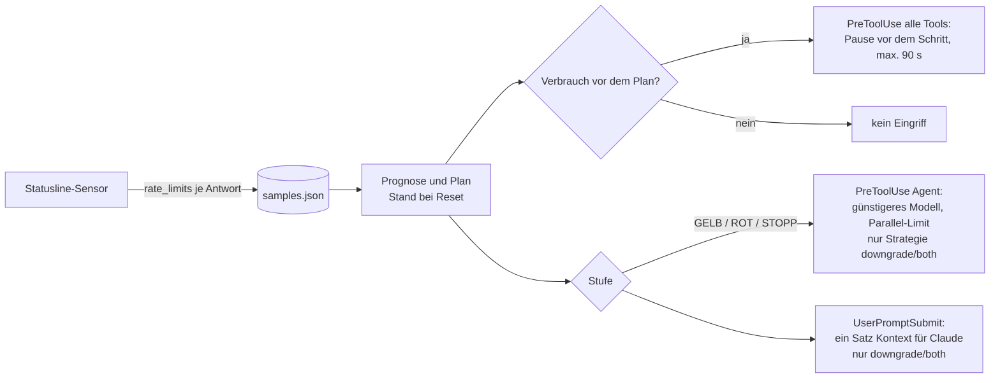

# quota-pacer

Claude-Code-Plugin, das die Arbeit rechtzeitig bremst, damit das 5-Stunden- und das Wochenkontingent des Claude-Abos bis zum Reset reichen.

## TL;DR

- **Was:** Ein Statusline-Sensor misst den Kontingentstand. Eine Prognose rechnet ihn bis zum Reset hoch. Liegt der Verbrauch vor dem Plan, macht das Plugin vor dem nächsten Tool-Schritt eine kurze Pause (Standard, höchstens 90 s). Wächst der Vorsprung trotzdem, werden die Pausen länger (bis 240 s) und es starten weniger, dann keine neuen Subagents. Modelle und Qualität bleiben gleich. Optional setzt es neue Subagents auf günstigere Modelle und begrenzt ihre Parallelität.
- **Was nicht:** Es spart keine Tokens, es verteilt sie über das Fenster. Es stellt das Modell des Hauptthreads nicht um, das kann kein Plugin. Eine einzelne lange Antwort von Claude hält es nicht an.
- **Installation in 3 Befehlen:**
  ```text
  /plugin marketplace add https://github.com/DerAlo/ari-auto-pacing.git
  /plugin install quota-pacer@ari-auto-pacing
  /quota-pacer:setup
  ```
  Zwischen Schritt 2 und 3 Claude Code neu starten.
- **Voraussetzungen:** Claude Code (getestet: 2.1.291 auf macOS, 2.1.294 auf Windows 11; ältere Versionen sind ungetestet), Node.js ≥ 18 im `PATH`, Login mit claude.ai-Abo (Pro, Max, Team, Enterprise). Bei API-Key, Bedrock oder Vertex liefert Claude Code keine Kontingentdaten; das Plugin greift dann nie ein.
- **Sicherheit:** Keine Abhängigkeiten außer Node. Im Zweifel greift das Plugin nicht ein (fail-open). Die Drossel trifft nie eine Berechtigungsentscheidung. Der Modellwechsel stuft nie hoch und umgeht weder `deny`/`ask`-Regeln noch den Auto-Mode-Klassifikator. Prompts und Transkriptinhalte werden nicht gespeichert.
- **Tests:** Testlauf mit dem ausgelieferten Code, 10 Runden je Ebene: 1360/1360 Unit- und Vertragstests (136 × 10), 300/300 End-to-End-Läufe gegen die echte CLI 2.1.291 (3680/3680 Prüfungen), 40/40 interaktive TUI-Läufe (1040/1040 Prüfungen), dazu der Installationspfad mit den Skills in 3 Läufen (90/90 Prüfungen). In keiner Runde ein Fehlschlag.

## Wie es funktioniert



1. **Sensor:** Claude Code gibt die Kontingentwerte (`rate_limits`) nur an die Statusline. Das Setup trägt deshalb einen kleinen Sensor als `statusLine` ein. Eine vorhandene Statusline wird weiter angezeigt.
2. **Prognose:** Aus den Messpunkten folgt die Burn-Rate in Prozentpunkten pro Minute. Sie wird bis zum Reset hochgerechnet. Daraus ergibt sich die Stufe (GRÜN, GELB, ROT, STOPP).
3. **Plan:** Für jedes Fenster gibt es eine Soll-Kurve: wie viel Prozent zum jetzigen Zeitpunkt verbraucht sein dürfen. Sie endet bei 100 % minus Reserve, mit einem Puffer, der erst am Ende freigegeben wird.
4. **Eingriff:** Je nach Strategie pausiert ein Hook vor jedem Tool-Schritt, oder ein Hook vor jedem Agent-Aufruf wählt Modell und Start.

Details: [docs/ARCHITEKTUR.md](docs/ARCHITEKTUR.md).

## Die drei Strategien

Einstellung `strategy` in `~/.claude/quota-pacer/config.json`.

| Strategie | Was passiert | Wann wählen |
| --- | --- | --- |
| `throttle` (Standard) | Pause vor dem nächsten Tool-Schritt, solange der Verbrauch dem Plan voraus ist. Modelle und Prompts bleiben unverändert. Bei großem Vorsprung (Standard: über 5 Punkte) längere Pausen und höchstens 1 Subagent gleichzeitig, ab 12 Punkten keine neuen Subagents. | Volle Qualität ist wichtiger als Tempo. Die Arbeit soll langsamer werden statt am Limit hart zu stoppen. Unbeaufsichtigte Läufe (`claude -p`) bremst sie nur, wenn parallel eine Terminal-Session misst (siehe Grenzen). |
| `downgrade` | Verhalten von 1.0.0: Ab GELB laufen neue Subagents auf Sonnet oder Haiku, und es starten weniger gleichzeitig. Keine Pausen. | Tempo ist wichtiger als die Qualität der Subagents. Viele parallele Subagents (Fan-out) treiben den Verbrauch. |
| `both` | Drossel immer. Ab ROT zusätzlich Modellwechsel, Parallel-Limit und Kontext für Claude. | Lange Sessions, in denen Pausen allein nicht reichen könnten. |

Die Drossel spart keine Tokens. Sie verschiebt Arbeit auf später im Fenster. Mehr Arbeit pro Kontingent bringt nur `downgrade` oder `both`.

## Stufen

Die Stufe wird immer berechnet und in der Statuszeile angezeigt (außer mit `enabled: false` oder `statusSegment: false`). Eingriffe nach Stufe gibt es nur bei `downgrade` (ab GELB) und `both` (ab ROT). Es gilt die schlechtere Stufe der beiden Fenster.

| Stufe | Auslöser 5-h-Fenster | Auslöser Wochenfenster | Routine-Agents¹ | Übrige | Geschützte² | Parallel |
| --- | --- | --- | --- | --- | --- | --- |
| GRÜN | Prognose < 90 % und Nutzung < 70 % | Prognose < 90 % und Nutzung < 80 % | unverändert | unverändert | unverändert | kein eigenes Limit³ |
| GELB | Prognose ≥ 90 % oder Nutzung ≥ 70 % | Prognose ≥ 90 % oder Nutzung ≥ 80 % | Haiku | Sonnet | unverändert | 3 |
| ROT | Prognose ≥ 95 % und Reserve in ≤ 90 min, oder Nutzung ≥ 85 % | Prognose ≥ 97 % oder Nutzung ≥ 92 % | Haiku | Haiku | Sonnet | 1 |
| STOPP | Nutzung ≥ 95 % | Nutzung ≥ 97 % | – | – | – | 0 |

¹ `Explore`, `claude-code-guide`, `statusline-setup` · ² `Plan` · ³ Ein eigenes Limit von Claude Code (`CLAUDE_CODE_MAX_CONCURRENT_SUBAGENTS`) gilt weiter; seinen Standardwert haben wir nicht geprüft.

Eine Prognose gibt es erst ab 15 Minuten Messdaten im Fenster; vorher zählen nur die Nutzungsschwellen. Alle Werte sind einstellbar: [docs/KONFIGURATION.md](docs/KONFIGURATION.md).

## Installation

Einmal pro Rechner, in Claude Code:

```text
/plugin marketplace add https://github.com/DerAlo/ari-auto-pacing.git
/plugin install quota-pacer@ari-auto-pacing
```

Das Repo ist öffentlich, `marketplace add` braucht keine Zugangsdaten.

Claude Code danach neu starten, dann:

```text
/quota-pacer:setup
```

Das Setup trägt den Sensor in `~/.claude/settings.json` ein (`statusLine` mit absolutem Pfad, `refreshInterval` 30 s). Vorher legt es ein Backup unter `~/.claude/quota-pacer/backups/` an. Plugins können die Statusline nicht selbst setzen, daher ist dieser Schritt nötig. Die Anzeige erscheint nach der nächsten Antwort von Claude.

Prüfen:

```text
/quota-pacer:status
```

Erwartet wird `Alles bereit.` und unter „Kontingentdaten“ mindestens ein Messpunkt. Steht dort `Login prüfen`, ist ein API-Key gesetzt; damit gibt es keine Kontingentdaten.

## Im Alltag

### Vorübergehend abschalten

```text
/quota-pacer:pause 2h
/quota-pacer:resume
```

`/quota-pacer:pause` schaltet alle Eingriffe ab: keine Drossel, kein Modellwechsel, kein Parallel-Limit. Dauer z. B. `30m`, `2h`, `1,5h`, `1d`; ohne Angabe 2 h, höchstens 7 Tage. Danach greift das Plugin von selbst wieder. Eine gerade laufende Drossel-Pause endet innerhalb einer Sekunde, und der Befehl selbst wartet nie hinter der Drossel. Die Statuszeile zeigt `pacing Pause bis 16:30`, neue Sessions melden die Pause beim Start. Der Sensor misst weiter. `/quota-pacer:resume` beendet die Pause vorzeitig. Beide Befehle startet nur der Nutzer, Claude ruft sie nicht selbst auf. Im Terminal: `node pacer.js pause 2h` bzw. `node pacer.js resume`.

Die Statuszeile zeigt ein Segment wie dieses:

| Anzeige | Bedeutung |
| --- | --- |
| `pacing GRÜN 5h 12%→41%@16:40 7d 39%` | 12 % des 5-h-Fensters verbraucht, beim jetzigen Tempo 41 % beim Reset um 16:40. Woche 39 %. Keine Pause. |
| `pacing GRÜN 5h 50%→89%@16:40 7d 41% Drossel 3s` | Der Verbrauch liegt knapp vor dem Plan. Der nächste Schritt wartet etwa 3 s. |
| `pacing GELB 5h 58%→112%@16:40 7d 41% Drossel 90s` | Vor dem Plan. Jeder Schritt wartet bis zu 90 s. |
| `pacing ROT 5h 29% 7d 80%→133% Drossel 240s` | Weit vor dem Plan (Halt). Jeder Schritt wartet 240 s, neue Subagents starten nicht. |
| `pacing ROT 5h 43%→49%@11:30 7d 44%→109%` | Die Woche bestimmt die Stufe: Beim jetzigen Tempo stünde sie beim Reset bei 109 %. Die Wochenprognose erscheint nur dann. |
| `pacing KEINE DATEN` | Kein Messpunkt der letzten 20 min. Die Messpunkte gelten für alle Sessions mit demselben Konfigurationsordner. Oder Login ohne Kontingentdaten. |
| `pacing config.json-Fehler (Eingriffe aus)` | `config.json` ist kein gültiges JSON. Bis zur Korrektur greift das Plugin nicht ein. |

Stufe und Drossel sind unabhängig. Die Drossel kann schon bei GRÜN greifen, wenn früh im Fenster viel verbraucht wurde.

Während einer Pause wartet Claude Code auf den Hook, die Statuszeile zeigt `Drossel Ns`. Das ist gewollt. Beim Einschalten erscheint einmal ein Hinweis im Chat:

```text
quota-pacer: Drossel aktiv – Pausen bis 90 s vor den nächsten Schritten, weil der Verbrauch dem Plan voraus ist (5-h-Fenster 58% genutzt, Plan 50%). Modelle bleiben unverändert.
```

Beim Ausschalten: `quota-pacer: Drossel aus – der Verbrauch liegt wieder im Plan.`

Mit `downgrade` erscheint bei jedem Wechsel zwischen GRÜN, GELB, ROT und STOPP ein Hinweis, mit `both` nur beim Wechsel nach oder von ROT/STOPP. Der Hinweis kommt mit dem nächsten Prompt, z. B. `quota-pacer: Stufe GELB (5h 29% → 102% bis 14:30, 7d 41%). Routine-Subagents laufen jetzt auf kleineren Modellen, höchstens 3 parallel.` Im Auto-Mode lehnt das Plugin einen Agent-Aufruf dann einmal ab und bittet Claude, ihn mit `"model": "haiku"` (oder `"sonnet"`) neu abzusetzen. Der neue Aufruf durchläuft den Auto-Mode-Klassifikator wie gewohnt.

Claude Code zeigt jede solche Ablehnung (Re-Issue, Parallel-Limit, STOPP) als `Error: PreToolUse:Agent hook error: Usage pacing level …`. Das ist kein Fehler des Plugins, sondern die gewollte Ablehnung.

`/quota-pacer:status` zeigt Stand, Prognose, Stufe, Strategie und Drossel im Detail.

## Grenzen

- Die Drossel wirkt nur zwischen Tool-Schritten. Eine Antwort ohne Tool-Aufruf läuft ohne Pause.
- Sie verteilt den Verbrauch, sie senkt ihn nicht. Ist das Kontingent schon fast leer, hilft nur Warten bis zum Reset.
- Eine Pause dauert höchstens `maxWaitSec` (Standard 90 s), bei großem Vorsprung bis `escalatedMaxWaitSec` (Standard und Maximum 240 s), damit der Prompt-Cache (5 min) nicht abläuft. Alle Tool-Aufrufe einer API-Antwort teilen sich eine Pause.
- Auch der Halt ist kein harter Stopp: Die Hauptsitzung arbeitet mit 240 s Pause je Schritt weiter. Wer dann pausenlos weiterarbeitet, kann das Limit trotzdem erreichen, nur deutlich später.
- Das Hauptmodell bleibt, wie es ist. Ein Wechsel per `/model` lohnt nur an Task-Grenzen, weil danach der Prompt-Cache neu aufgebaut wird.
- Kontingentdaten kommen erst mit der ersten Antwort einer Session und nur in Sessions mit Statusline (CLI im Terminal). `claude -p` und die Desktop-App liefern selbst keine Messpunkte. Sie nutzen aber die Messpunkte paralleler Terminal-Sessions mit demselben Konfigurationsordner, solange diese höchstens 20 min alt sind. Ein nächtlicher `claude -p`-Lauf ohne Terminal-Session wird also nicht gebremst.
- Messpunkte älter als 20 min gelten als veraltet. Dann greift das Plugin nicht ein.
- Die separaten Wochenlimits pro Modell sind nicht in `rate_limits` enthalten.
- `CLAUDE_CODE_SUBAGENT_MODEL_FORCE=1` hebelt den Modellwechsel aus. Dann greift bei `downgrade` nur das Parallel-Limit. Die Drossel ist davon nicht betroffen.
- Mit `allowManagedHooksOnly` in den Managed Settings laufen keine Plugin-Hooks.
- Die Prozente kommen als ganze Zahlen an. Der Wochenplan steigt nur um etwa 0,007 Punkte pro Minute. Deshalb gilt im Wochenfenster ein Vorsprung unter 1 Punkt als im Plan; darüber wächst die Pause mit dem Vorsprung und erreicht 90 s erst bei 4 Punkten (`weeklyDeadbandPct`, `weeklyRampPct`). Echte Daten: 46 % bei Plan 44,3 % ergaben 20 s je Schritt.
- Die Installation kopiert das ganze Repo in den Plugin-Cache: etwa 0,1 MB Plugin, der Rest Doku und Tests.
- Windows: ab 1.1.1 mit den Unit-Tests und im Alltag geprüft (Windows 11, Claude Code 2.1.294). Die End-to-End-Läufe liefen nur auf macOS.

## Fehlersuche

| Symptom | Ursache und Abhilfe |
| --- | --- |
| Statuszeile zeigt `pacing KEINE DATEN` | Kein Messpunkt der letzten 20 min: noch keine Antwort, oder die letzte Session ist länger her. Oder Login per API-Key, Bedrock oder Vertex; `/status` zeigt den Login-Typ, `doctor` warnt bei gesetztem API-Key. |
| Statuszeile leer, kein `pacing`-Segment | `node` fehlt im `PATH` (siehe unten), der Sensor ist nicht eingetragen (`/quota-pacer:status`), oder `enabled: false` bzw. `statusSegment: false` in `config.json`. |
| Hinweis „Der Kontingent-Sensor ist noch nicht aktiv“ | `/quota-pacer:setup` ausführen. |
| Claude scheint zu hängen | Drossel-Pause. Die Statuszeile zeigt `Drossel Ns`. Bei großem Vorsprung dauern die Pausen bis 240 s (`/quota-pacer:status` zeigt „verschärft“ oder „Halt“). Vorübergehend aus: `/quota-pacer:pause 1h`. Kürzere Pausen: `throttle.maxWaitSec` und `throttle.escalatedMaxWaitSec` senken. Pausen abschalten: `"throttle": { "maxWaitSec": 0 }`. Alle Eingriffe aus: `"enabled": false`. Jeweils das Feld in `config.json` ergänzen. |
| Drossel pausiert, obwohl das 5-h-Fenster niedrig ist | Das Wochenfenster kann führen. `/quota-pacer:status` zeigt in der Zeile „Drossel“, welches Fenster die Pause auslöst. Die Woche pausiert erst ab 1 Punkt Vorsprung, mit 90 s erst ab 4 Punkten. |
| Statuszeile zeigt ROT, obwohl das 5-h-Fenster niedrig ist | Die Woche: Prognose ≥ 97 % oder Nutzung ≥ 92 %. Die Statuszeile zeigt dann die Wochenprognose (`7d 44%→109%`). Bei `throttle` ist die Stufe nur Anzeige. |
| `Error: PreToolUse:Agent hook error: Usage pacing level …` | Gewollte Ablehnung eines Agent-Aufrufs bei `downgrade` oder `both` (Re-Issue im Auto-Mode, Parallel-Limit, STOPP). Kein Fehler. |
| `Error: PreToolUse:Agent hook error: Usage pacing: usage is N points ahead …` | Gewollte Ablehnung bei `throttle` oder `both`: Der Verbrauch liegt weit vor dem Plan, die Drossel lässt höchstens 1 oder keinen neuen Subagent zu. Die Aufgabe läuft in der Hauptsitzung weiter. Abschalten: `"throttle": { "escalateLeadPct": 100, "haltLeadPct": 100 }`. |
| `hook error … Failed with non-blocking status code … Executable not found in $PATH: "node"`, bei `/quota-pacer:status` `command not found: node` | `node` fehlt im `PATH` der Claude-Code-Umgebung. Die Meldung kommt bei jedem Sessionstart, Prompt und Tool-Aufruf, die Statuszeile bleibt leer; die Tools laufen weiter. `node --version` im selben Terminal prüfen. Aus einer IDE oder der Desktop-App gestartet, kann der `PATH` ein anderer sein als im Terminal. |
| `pacing config.json-Fehler`, oder eine Einstellung wirkt nicht | `config.json` ist kein gültiges JSON, z. B. ein Komma nach dem letzten Feld. Bis zur Korrektur sind alle Eingriffe aus. `/quota-pacer:status` nennt die Stelle. |
| `config.json – ungültige Felder auf Standard gesetzt` | Das genannte Feld hat einen ungültigen Wert. Nur dieses Feld fällt auf den Standard zurück. Werte: [docs/KONFIGURATION.md](docs/KONFIGURATION.md). |
| Entscheidungen nachvollziehen | Jede Entscheidung und jede Pause steht als JSON-Zeile in `~/.claude/quota-pacer/decisions.jsonl` (rotiert bei 1 MB). |

## Deinstallation

In dieser Reihenfolge:

```text
/quota-pacer:setup uninstall
/plugin uninstall quota-pacer
/plugin marketplace remove ari-auto-pacing
```

Das erste Kommando entfernt den Sensor und stellt die vorherige Statusline wieder her. Das zweite entfernt die Hooks, das dritte den Marketplace-Eintrag in `settings.json`.

Plugin schon entfernt, aber die Statuszeile zeigt noch `pacing`? Dann gibt es `/quota-pacer:setup` nicht mehr. Im Terminal hilft:

```text
node ~/.claude/quota-pacer/bin/pacer.js uninstall
```

Erst wenn der Sensor ausgetragen ist, darf `~/.claude/quota-pacer/` gelöscht werden; sonst zeigt `statusLine` auf eine fehlende Datei, und die Backups der `settings.json` sind mit weg. Claude Code lässt die Kopie im Plugin-Cache (`~/.claude/plugins/cache/ari-auto-pacing/`) nach beiden `/plugin`-Befehlen liegen; sie kann von Hand gelöscht werden.

## Entwicklung

Tests brauchen Node ≥ 22 (Glob in `node --test`). Die E2E-Läufe brauchen kein Konto und kein Netz: Sie laufen mit temporärem `HOME`, Fake-Credentials und einem lokalen Mock der Messages API.

```bash
npm test                 # Unit- und Vertragstests
npm run test:coverage    # mit Coverage
npm run test:e2e -- --claude "$(command -v claude)"           # echte CLI gegen Mock-API, 30 Szenarien
npm run test:e2e -- --claude "$(command -v claude)" --rounds 3 --only throttle-default-ahead
npm run test:interactive -- --claude "$(command -v claude)"   # TUI im Pseudo-Terminal (macOS/Linux, python3)
npm run test:skills -- --claude "$(command -v claude)"        # Installation mit claude plugin, Skills per claude -p
npm run bench            # Hook-Latenzen
npm run sim              # Stufen-Simulation, 5 Lastprofile
npm run sim:throttle     # Drossel-Simulation 5 h, 5 Lastprofile
npm run sim:throttle-week   # Drossel-Simulation Woche, ganzzahlige Messwerte (einige Minuten)
T="$(mktemp -d)"; HOME="$T" CLAUDE_CONFIG_DIR="$T/.claude" claude plugin validate --strict .   # Marketplace- und Hook-Manifest
```

`scripts/pacer.js install` und `uninstall` schreiben in `settings.json`. Zum Ausprobieren deshalb mit einem temporären `HOME` oder `CLAUDE_CONFIG_DIR` aufrufen.

| Pfad | Inhalt |
| --- | --- |
| `.claude-plugin/` | `plugin.json`, `marketplace.json` (Marketplace `ari-auto-pacing`, Plugin im Repo-Root) |
| `hooks/hooks.json` | 8 Hook-Einträge auf 7 Ereignissen, exec form (`node` + Skriptpfad, ohne Shell) |
| `scripts/hook.js` | alle Hook-Ereignisse |
| `scripts/statusline.js` | Sensor und Statuszeilen-Segment |
| `scripts/pacer.js` | `install`, `uninstall`, `status [--json]`, `doctor`, `pause [Dauer]`, `resume` |
| `scripts/lib/` | Prognose, Drossel, Policy, Modellauflösung, Transkript, Regeln, Registry, Installer, Texte |
| `skills/` | `/quota-pacer:setup`, `/quota-pacer:status`, `/quota-pacer:pause`, `/quota-pacer:resume` (nur auf Aufruf) |
| `test/` | Unit- und Vertragstests, E2E (headless, interaktiv, Skills) mit Mock-API, Benchmark, Simulationen |
| `docs/` | [Architektur](docs/ARCHITEKTUR.md), [Konfiguration](docs/KONFIGURATION.md) |
| `CHANGELOG.md` | Versionen |

## Statistik

Stand 6. Oktober 2026, quota-pacer 1.1.0 (ausgelieferter Code), Claude Code 2.1.291, macOS arm64, Node v22.23.1. Alle Läufe nacheinander als normaler Benutzer, in einer leeren Umgebung mit Temp-HOME. Die Zahlen gelten für 1.1.0; für 1.1.1 liefen die 145 Unit- und Vertragstests zusätzlich unter Windows 11 (144 bestanden, 1 übersprungen).

| Kennzahl | Ergebnis |
| --- | --- |
| Unit- und Vertragstests | 136 Tests × 10 = 1360/1360, 0 übersprungen, 12,4–12,7 s je Runde |
| End-to-End headless | 30 Szenarien × 10 = 300/300 Läufe, 3680/3680 Prüfungen |
| End-to-End interaktiv (TUI) | 4 Läufe × 10 = 40/40 Läufe, 1040/1040 Prüfungen |
| Installationspfad mit Skills (`claude plugin …`, Skills per `claude -p`) | 3 Läufe × 30 = 90/90 Prüfungen |
| `claude plugin validate --strict` | bestanden: Marketplace (`marketplace.json`) und `plugin.json` |
| Frische Installation im Temp-HOME | 10/10 Schritte mit Exit-Code 0 (`plugin validate` ×2, `marketplace add`, `plugin install`, `plugin list`, `pacer.js install/status/doctor/uninstall/status` direkt, ohne Skills) |
| Coverage Zeilen / Branches / Funktionen | 97,58 % / 81,36 % / 91,05 % (`npm run test:coverage`, Kindprozesse mitgezählt); Gegenprobe über 289 Prozesse: 96,01 % / 83,03 % / 91,05 % |
| Hook-Latenz (ohne Pause, 40 Läufe je Pfad) | p50 45,2–58,6 ms, p95 47,7–186,9 ms; Node-Start p50 33,7 ms |
| Drossel-Pause im E2E, `maxWaitSec` 2,5 s | 2586–2595 ms (Hauptsitzung), 2572–2602 ms (Subagent); im Plan 56–73 ms |
| Stufen-Simulation, dauerhaft 0,40 %/min | GELB ab Minute 16, ROT ab 148, STOPP ab 238 (222 min Vorlauf) |
| Drossel-Simulation 5 h, gleichmäßig 0,40 %/min | ohne Drossel 250 min Arbeit, dann 50 min gesperrt; mit Drossel 225 min Arbeit (−10 %), nie gesperrt, Ende bei 90,1 % statt 95 %, längste Pause 21,5 s |
| Drossel-Simulation Woche, Profil wie die echten Daten | ohne Drossel gesperrt ab Freitag 11:39 Uhr; mit Drossel nie gesperrt, 59 statt 66,7 h Arbeit, längste Pause 69 s, keine Serie voller Pausen (Drossel vor dem Review: 126 min) |
| Gefundene Fehler | 23 beim Neuaufbau, 9 weitere im Review; alle behoben (siehe [CHANGELOG](CHANGELOG.md)) |

Die Latenz-Ausreißer (p95 bis 187 ms, max 200 ms) kommen von je einem langsamen Dateizugriff auf dem Testrechner; der Hook-Code selbst lief in diesen Läufen normal.

Nicht belegt: getippte `/plugin`- und Skill-Befehle in der TUI, andere Claude-Code-Versionen als die genannten, Desktop-App und IDE-Erweiterungen, Managed Settings als MDM-Profil auf einem verwalteten Mac.

## Lizenz

[MIT](LICENSE) © 2026 Alfons Riedhammer
