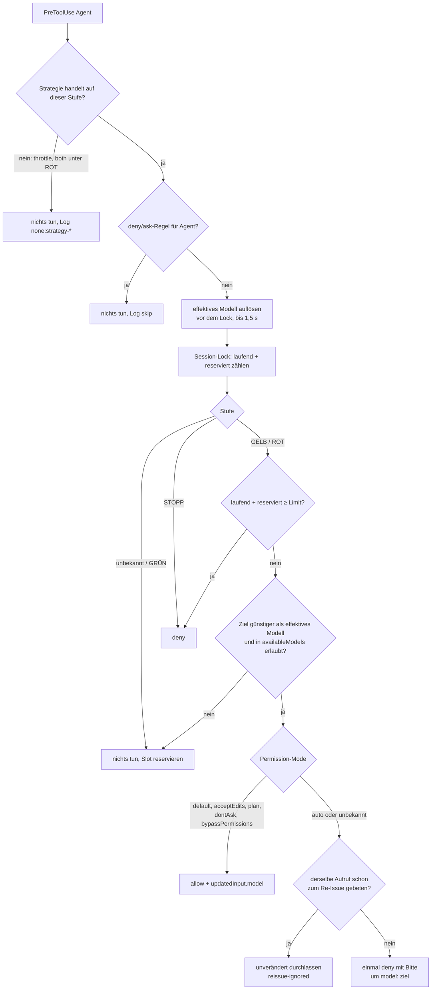

# Architektur

Stand: Version 1.1.1, geprüft gegen Claude Code 2.1.291 (macOS arm64) und 2.1.293 (Windows 11, nur `npm test`); 1.0.0 lief auf 2.1.289. Ältere Versionen sind ungetestet. `doctor` meldet unter 2.1.251 `FAIL` (Modell-Reihenfolge laut Doku) und zwischen 2.1.251 und 2.1.288 `WARN`: Hooks in der exec form (`args`), `PostModelSwitch` und `refreshInterval` sind nur auf 2.1.289 und 2.1.291 belegt.

## Komponenten

| Komponente | Datei | Ausgelöst durch | Aufgabe |
| --- | --- | --- | --- |
| Sensor | `scripts/statusline.js` (Kopie in `~/.claude/quota-pacer/bin/`) | Claude Code: Sessionstart, nach jeder Antwort, nach `/model`, alle 30 s (`refreshInterval`) | speichert `rate_limits` als Messpunkt, merkt sich das Hauptmodell (`model.id`), zeigt das Segment, ruft eine vorherige Statusline mit demselben stdin auf |
| Prognose | `scripts/lib/forecast.js` | jeder Hook, jede Statusline | Fensterstand, Burn-Rate, Hochrechnung bis zum Reset |
| Drossel | `scripts/lib/throttle.js` | PreToolUse auf alle Tools, Statusline, `status` | Soll-Kurve je Fenster, Pause bis der Plan aufholt |
| Policy | `scripts/lib/policy.js` | jeder Hook | Stufe je Fenster mit Hysterese, Entscheidung pro Spawn, Strategie-Weiche |
| Modellauflösung | `scripts/lib/models.js`, `scripts/lib/transcript.js` | PreToolUse `Agent` | Modell, auf dem der Subagent ohne Plugin liefe |
| Regeln | `scripts/lib/permissions.js` | PreToolUse `Agent`, `doctor` | `deny`/`ask`-Regeln, `availableModels`/`deniedModels`, `allowManagedHooksOnly` aus allen Settings-Quellen |
| Verkettung | `scripts/lib/chain.js` | Statusline, `install`, `uninstall` | vorherige Statusline in `chain.json` (nicht in `config.json`, die Nutzer von Hand bearbeiten) |
| Re-Issue-Schutz | `scripts/lib/reissue.js` | PreToolUse `Agent` | Hash pro Aufruf, verhindert eine Ablehnungsschleife |
| Registry | `scripts/lib/registry.js` | PreToolUse `Agent`, SubagentStart/Stop | laufende Subagents und Reservierungen je Session |
| Texte | `scripts/lib/messages.js` | alle | Hinweise an dich (Deutsch oder Englisch), Texte an Claude (Englisch) |
| Hooks | `scripts/hook.js` | `hooks/hooks.json` | siehe nächste Tabelle |
| CLI | `scripts/pacer.js` | Skills `/quota-pacer:setup`, `/quota-pacer:status`, `/quota-pacer:pause`, `/quota-pacer:resume` | install, uninstall, status, doctor, pause, resume |

Die Statusline zeigt auf eine Kopie im Datenverzeichnis, weil sich der Plugin-Pfad im Cache mit jeder Version ändert. `SessionStart` erneuert die Kopie, sobald die Version abweicht.

### Hooks

Alle Einträge in `hooks/hooks.json` nutzen die exec form: `"command": "node"`, `"args": ["${CLAUDE_PLUGIN_ROOT}/scripts/hook.js", "<modus>"]`. Claude Code startet den Prozess dann ohne Shell.

| Ereignis | Matcher | Modus | Timeout | Aufgabe |
| --- | --- | --- | --- | --- |
| SessionStart | – | `session-start` | 10 s | Hauptmodell merken, Skripte synchronisieren, Erinnerungen (je höchstens einmal pro 24 h), alte Sessions (> 3 Tage) löschen |
| UserPromptSubmit | – | `prompt` | 10 s | Kontext für Claude und Hinweis bei Stufenwechsel (nur `downgrade`/`both`) |
| PreToolUse | `Agent\|Task` | `pre-agent` | 10 s | Modellwechsel, Parallel-Limit, Re-Issue (nur `downgrade`/`both`); Parallel-Limit der verschärften Drossel (`throttle`/`both`) |
| PreToolUse | `*` | `throttle` | 300 s | Pause vor dem Schritt (nur `throttle`/`both`) |
| SubagentStart | – | `subagent-start` | 5 s | Reservierung in laufenden Agent umwandeln |
| SubagentStop | – | `subagent-stop` | 5 s | laufenden Agent austragen |
| PostModelSwitch | – | `model-switch` | 5 s | neues Hauptmodell merken |
| SessionEnd | – | `session-end` | 5 s | Session-Zustand löschen |

Bei einem Agent-Aufruf laufen beide PreToolUse-Einträge parallel; Claude Code wartet auf beide. PreToolUse feuert auch für Tool-Aufrufe in Subagents, mit derselben `session_id` wie der Hauptthread.

## Prognose

Pro Fenster (5 h, 7 Tage):

1. **Aktuelles Fenster:** Messpunkte mit dem spätesten `resets_at` in der Zukunft (Toleranz ±180 s). Ein `resets_at`, das mehr als eine Fensterlänge entfernt ist, wird verworfen. Sind alle Fenster vorbei, gilt der Stand als zurückgesetzt (0 %).
2. **Ohne `resets_at`:** Die Fenstergrenzen sind unbekannt. Es zählt nur der neueste Messpunkt, eine Prognose gibt es nicht.
3. **Veraltete Werte verwerfen:** Innerhalb eines Fensters fällt die Nutzung nie. Eine untätige zweite Session meldet aber weiter ihren alten Wert. Deshalb zählt nur die monotone Hüllkurve.
4. **Frische:** Ist der letzte Messpunkt älter als 20 min, ist der Stand „veraltet“. Stufe „unbekannt“, keine Pause, kein Eingriff.
5. **Anlaufphase:** Eine Prognose gibt es erst, wenn die Messpunkte im Fenster mindestens 15 min umspannen (`minForecastMinutes`). Vorher gelten nur die Nutzungsschwellen. Sonst würde ein kurzer Burst zu Sessionbeginn sofort ROT auslösen.
6. **Burn-Rate 5 h:** Kleinste-Quadrate-Steigung über die letzten 30 min (mindestens 3 Punkte über 5 min), gemischt mit dem Fensterdurchschnitt. Gewicht = abgedeckte Spanne / 30 min.
7. **Burn-Rate 7 Tage:** Es gibt zwei Maße für den Fortschritt: Uhrzeit (vergangene Zeit / 7 Tage) und Arbeitszeit (vergangene / alle Arbeitsminuten im Fenster; Standard ist die ganze Woche, dann sind beide gleich). Das größere zählt, wie bei der Drossel. Führt die Uhrzeit, gilt `projected = used / Uhrzeit-Anteil`, sonst `used / Arbeitszeit-Anteil`. Erst ab 120 Arbeitsminuten gibt es eine Prognose.
8. **Ergebnis:** `projected = used + rate × restliche Minuten`. Für das 5-h-Fenster zusätzlich `minutesToReserve = (100 − Reserve − used) / rate`.

## Stufen

Für jedes Fenster wird geprüft, mit H = 100 − Reserve (5 h: 95 %, 7 Tage: 97 %):

| Stufe | Bedingung |
| --- | --- |
| STOPP | `used ≥ H` |
| ROT | `used ≥ red.usedPct`, oder `projected ≥ H` und (nur 5 h) `minutesToReserve ≤ 90` |
| GELB | `used ≥ amber.usedPct` oder `projected ≥ amber.projectedPct` |
| GRÜN | sonst |

Die Gesamtstufe ist die schlechtere der beiden. Hysterese: Wer auf GELB oder ROT steht, verlässt die Stufe erst, wenn die Prognose 8 Prozentpunkte unter die Schwelle fällt; die Zeitgrenze für ROT wächst dabei um 50 %. Ein neues Fenster beginnt ohne Hysterese.

Welche Strategie bei welcher Stufe handelt:

| Strategie | Drossel | Modellwechsel, Parallel-Limit, Kontext für Claude |
| --- | --- | --- |
| `throttle` | bei jeder Stufe, wenn der Verbrauch vor dem Plan liegt | nie; nur das Parallel-Limit der verschärften Drossel |
| `downgrade` | nie | ab GELB |
| `both` | bei jeder Stufe, wenn der Verbrauch vor dem Plan liegt | ab ROT |

## Drossel

Die Drossel reagiert nicht auf die gemessene Burn-Rate. Die hinkt jeder Pause um den Rückblick von 30 min hinterher, und die Regelung würde schwingen. Stattdessen folgt sie einer Soll-Kurve (Plan).

### Soll-Kurve

```text
allowed(f) = T · f + slack · (1 − f) + buffer · release(f)

f        Anteil des Fensters, der vergangen ist (0 … 1)
T        100 − reservePct − bufferPct        Ziel des Plans
slack    min(earlySlackPct, T)               Spielraum am Fensteranfang
release  0 bis f = 1 − releaseFraction, dann linear bis 1 bei f = 1
```

Mit den Standardwerten (Reserve 5 %, Puffer 10 %, Anfangsspielraum 15 %, Freigabe in den letzten 10 %):

| f | 0 | 0,5 | 0,9 | 0,95 | 1 |
| --- | --- | --- | --- | --- | --- |
| allowed 5 h | 15 % | 50 % | 78 % | 86,5 % | 95 % |
| allowed 7 Tage (Reserve 3 %) | 15 % | 51 % | 79,8 % | 88,4 % | 97 % |

- **Puffer:** Der Plan zielt auf Reserve plus Puffer, nicht auf die Reserve. Eine zu spät erkannte Last hat so noch 10 Punkte Platz.
- **Anfangsspielraum:** Ein normaler Start ins Fenster wird nicht gebremst. Bei f = 0 sind 15 % erlaubt.
- **Freigabe:** In den letzten 10 % des Fensters wird der Puffer schrittweise freigegeben. Er verfällt sonst ungenutzt beim Reset.

### Pause

```text
ahead     = used − allowed(f)
slope     = allowed(f eine Minute später) − allowed(f)       in %-Punkten pro Minute
catchUp   = ahead / slope × 60 s                             unendlich, wenn slope = 0
waitSec   = 0,                                    wenn ahead ≤ 0 oder catchUp < minWaitSec
            min(maxWaitSec, catchUp auf 0,1 s gerundet)   sonst
```

Im Wochenfenster kommen Totband und Rampe dazu (siehe unten). Beide Fenster werden geprüft; die längere Pause gilt. Beispiel 5 h, Fenstermitte: Der Plan wächst um (85 − 15) / 300 = 0,23 Punkte pro Minute. Liegt der Verbrauch 1 Punkt vor dem Plan, bräuchte der Plan 4,3 min zum Aufholen. Die Pause wird auf 90 s gekappt. Nach dem nächsten Schritt wird neu gerechnet.

`minWaitSec` (2 s) wird mit der Aufholzeit verglichen, nicht mit der gekappten Pause. So pausiert die Drossel auch dann, wenn `maxWaitSec` kleiner als `minWaitSec` ist.

### Wochenfenster: f = max(Uhrzeit-Anteil, Arbeitszeit-Anteil)

Für das Wochenfenster gibt es zwei Maße für den Fortschritt:

- **Uhrzeit:** vergangene Zeit / 7 Tage.
- **Arbeitszeit:** vergangene Arbeitsminuten / alle Arbeitsminuten im Fenster. Standard seit 1.4.0 ist die ganze Woche (0–24 Uhr, alle Tage); dann ist die Arbeitszeit gleich der Uhrzeit. Bis 1.3.0 galt Mo–Fr 7–19 Uhr.

Die Drossel nimmt das größere. Sie pausiert also nur, wenn der Verbrauch beiden Plänen voraus ist.

Warum: Arbeitszeit allein bremst jeden, der auch abends oder am Wochenende arbeitet. Das zeigten echte Daten aus diesem Konto. Dienstag 08:12 Uhr standen 39 % der Woche, Reset am Samstag 15:00 Uhr. Nach Arbeitszeit waren erst etwa 22 % der Woche vorbei, der Plan lag bei rund 31 %. Jeder Schritt hätte 90 s gewartet. Nach Uhrzeit waren 2,72 von 7 Tagen vorbei (f = 0,39), der Plan lag bei rund 42,9 %: keine Pause.

Uhrzeit allein wiederum lässt jemanden, der nur werktags arbeitet, zur Wochenmitte vorauslaufen. Beispiel mit Arbeitszeit Mo–Fr 8–18 Uhr und Reset Montag 12 Uhr: Mittwoch 12 Uhr ist der Arbeitszeit-Anteil 0,4, der Uhrzeit-Anteil 0,29. Welches Maß führt, hängt vom Reset-Tag ab. Beim Reset Samstag 15 Uhr und den Standardwerten führt am Mittwoch 12 Uhr die Uhrzeit (0,55 gegen 0,48).

Warum der Standard seit 1.4.0 die ganze Woche ist: Mit Mo–Fr 7–19 Uhr ließ das größere Maß jeden zu weit laufen, der auch nachts und am Wochenende arbeitet. Echte Daten: Reset Mittwoch 05:00 Uhr, Freitag 19:30 Uhr standen 61 % der Woche. Nach Uhrzeit waren 37 % der Woche vorbei, nach Arbeitszeit 60 % (36 von 60 h). Der Plan lag bei 58 %, die Drossel sah nur 3 Punkte Vorsprung und verschärfte nie. Über das Wochenende wäre der Plan bei rund 60 % stehen geblieben. Mit der ganzen Woche lag der Plan bei 42 %, und die Drossel ging auf Halt.

Folge, wenn das Wochenende mitten im Fenster liegt: Der Arbeitszeit-Plan steht still, und die Uhrzeit kann darunter liegen. Ein Überschuss wird dann bis Montag nicht aufgeholt. Beispiel mit Arbeitszeit Mo–Fr 8–18 Uhr und Reset Montag 12 Uhr: Samstag 12 Uhr sind 46 von 50 Arbeitsstunden vorbei, Plan 83,24 %. 80 % sind im Plan; 85 % liegen 1,76 Punkte vorn und pausieren mit Totband und Rampe 22,8 s je Schritt (ohne beides: 90 s). Liegt das Wochenende am Anfang oder Ende des Fensters, wie beim Reset Samstag 15 Uhr, tritt das nicht auf.

#### Totband und Rampe im Wochenfenster

Der Wochenplan steigt mit Standardwerten um (87 − 15) / 10 080 ≈ 0,007 Punkte pro Minute, solange der Uhrzeit-Anteil führt. Die Aufholzeit ist deshalb für jeden Vorsprung länger als `maxWaitSec`. Ohne Ausgleich gab schon 0,1 Punkt Vorsprung die volle Pause von 90 s je API-Antwort, etwa 14 min lang; ein Sprung um 1 Punkt hätte bis zu etwa 140 min maximale Pausen bedeutet. Das Testkonto lieferte die Prozente als ganze Zahlen (die CLI gibt eine Nachkommastelle weiter, der Server lieferte keine). Echte Daten vom 6. Oktober 2026, 10:19 und 10:26 Uhr: 44 % genutzt, Plan 43,9 %, Meldung „Wochenfenster 44% genutzt, Plan 44%“.

Seit dem Review gilt im Wochenfenster:

```text
excess    = ahead − weeklyDeadbandPct                       (Standard 1 Punkt)
waitSec   = 0,                                              wenn excess ≤ 0
            min(maxWaitSec, catchUp) · min(1, excess / weeklyRampPct)   sonst (Standard 3 Punkte)
```

Ein Vorsprung unter 1 Punkt ist also im Plan. Darüber wächst die Pause gleichmäßig und erreicht 90 s bei 4 Punkten Vorsprung. Die Arbeit wird langsamer statt in Serien voller Pausen zu stocken. Das 5-h-Fenster hat kein Totband: Dort holt der Plan 1 Punkt in etwa 4 min auf. Wochen-Simulation mit ganzzahligen Messwerten: `npm run sim:throttle-week`.

#### Stufen-Prognose der Woche

Sie nimmt seit dem Review dasselbe größere Maß wie die Drossel. Mit den echten Daten (Dienstag 10:48 Uhr, 44 %, Reset Samstag 15 Uhr) sinkt die Prognose damit von 167 % (nur Arbeitszeit) auf 109 % (Uhrzeit). Das ist weiter ROT: Bei diesem Tempo reicht die Woche nicht. Bei `throttle` ist die Stufe nur Anzeige. Bei `downgrade` oder `both` laufen neue Subagents dann auf Haiku. Damit der Grund sichtbar ist, zeigt die Statuszeile die Wochenprognose, sobald die Woche die Stufe bestimmt: `pacing ROT 5h 43%→49%@11:30 7d 44%→109%`.

### Eine Pause pro API-Antwort

Claude Code führt die Tool-Aufrufe einer Antwort, die schreiben, nacheinander aus. Würde jeder Aufruf einzeln pausieren, warteten vier Edits 4 × 90 s = 6 min. Dann wäre der Prompt-Cache (5 min) abgelaufen, und die nächste Anfrage würde teurer. Deshalb teilen sich alle Tool-Aufrufe einer API-Antwort eine Pause:

1. Der Hook sucht im Transkript die Zeile dieses Aufrufs (`tool_use_id`) und liest die Nachrichten-ID (`message.id`). Er wartet darauf höchstens `min(1 s, waitSec)`. In einem Subagent nimmt er das Transkript des Subagents.
2. Unter einem Lock schaut er in `sessions/<id>/throttle-budget.json` nach. Gibt es für diese Nachricht schon ein Pausenende, wartet er bis dahin. Sonst trägt er sein eigenes Ende ein und wartet voll.
3. Ist das gemeinsame Ende schon vorbei, läuft der Aufruf sofort (`throttle-skip`, Grund `response-budget-used`).
4. Ohne Transkriptzeile pausiert der Aufruf voll.

Parallel laufende Aufrufe einer Antwort (z. B. mehrere Agent-Spawns) warten alle bis zum selben Ende. So bremst die Drossel auch einen Fan-out, ohne die Pause zu vervielfachen.

### Verschärfung bei großem Vorsprung

Die Pause allein hält einen großen Vorsprung nicht auf: Die Obergrenze begrenzt, wie stark ein Schritt gebremst wird, und mehrere Subagents verbrauchen zwischen zwei Pausen parallel. Echte Daten: Im Wochenfenster stand jede Pause an der Obergrenze von 90 s, und der Vorsprung wuchs trotzdem binnen eines Tages von 7 auf 22 Punkte. Deshalb wächst die Bremse mit dem Vorsprung `ahead = used − allowed`, in beiden Fenstern:

| Stufe | Vorsprung (Standard) | Längste Pause | Subagents |
| --- | --- | --- | --- |
| 0 | bis `escalateLeadPct` (5) | `maxWaitSec` (90 s) | unbegrenzt |
| 1 „verschärft“ | über 5 bis unter 12 | steigt gleichmäßig von 90 s auf `escalatedMaxWaitSec` (240 s) | höchstens `escalatedAgentCap` (1) gleichzeitig |
| 2 „Halt“ | ab `haltLeadPct` (12) | 240 s | keine neuen |

Es zählt das Fenster mit der höheren Stufe. Wie die Pause folgt die Verschärfung dem Vorsprung und nicht der gemessenen Rate, damit sie nicht schwingt. Der Halt blockiert keine Tools: Die Hauptsitzung arbeitet mit der längsten Pause weiter, nur neue Subagents lehnt `pre-agent` ab (Log `pre-agent`, Grund `throttle-stage-1` oder `throttle-stage-2`). Die Ablehnung nennt Claude den Vorsprung und dass die Aufgabe in der Hauptsitzung weiterlaufen kann. Im Halt pausiert die Drossel den abgelehnten Agent-Aufruf nicht (`throttle-skip`, Grund `agent-call-halt`).

### Vorübergehende Pause

`pacer.js pause` schreibt das Ende nach `pause.json`; `loadConfig()` setzt bis dahin `enabled: false`, für Hooks, Statuszeile und `status` gleichermaßen. Getrennt von `config.json`, damit eine Pause keine Einstellung des Nutzers überschreibt und von selbst endet. Eine laufende Drossel-Pause schläft in Schritten von 1 s und endet, sobald `pause.json` gilt. Bash- und PowerShell-Aufrufe von `pacer.js pause` oder `resume` pausiert die Drossel nie: Sonst müsste der Befehl, der die Drossel abschaltet, im Halt erst 240 s warten. Die Skills haben `disable-model-invocation`, damit Claude die Bremse nicht selbst löst.

### Warum `maxWaitSec` höchstens 240 s

Der Prompt-Cache läuft standardmäßig nach 5 min ab. Eine längere Pause würde den gesamten Kontext neu in den Cache schreiben lassen. Das kostet mehr Kontingent, als die Pause spart. Deshalb: Standard 90 s, erlaubt 0–240 s, lieber mehr kurze Pausen als wenige lange. Dieselbe Grenze gilt für `escalatedMaxWaitSec`. Der Hook-Timeout liegt bei 300 s, über dem erlaubten Maximum. Ein Timeout würde die Pause nur früher beenden: Claude Code lässt den Aufruf dann unverändert laufen (geprüft mit 2.1.291).

### Meldungen und Zustand

Der Zustand „Drossel an/aus“ und die Stufe der Verschärfung stehen je Session in `throttle.json`; auch ein Stufenwechsel wird gemeldet. Nur der Hook, der den Wechsel unter einem Lock einträgt, meldet ihn. Parallele Aufrufe melden also einmal. Die Drossel gibt nie eine Berechtigungsentscheidung zurück, nur `systemMessage`. Bei `both` und ROT/STOPP pausiert sie Agent-Aufrufe nicht (`throttle-skip`, Grund `agent-call-downgrade`). Die entscheidet dort die Downgrade-Policy, und ein Re-Issue würde sonst pro Versuch eine volle Pause kosten.

## Entscheidung pro Agent-Aufruf



Jede Entscheidung schreibt genau eine Zeile `kind: "pre-agent"` in `decisions.jsonl`.

### Nie hochstufen

Das effektive Modell folgt der Reihenfolge von Claude Code (ab 2.1.251):

1. `model` im Aufruf
2. `model` in der Agent-Definition (`.claude/agents/**` vom Arbeitsverzeichnis aufwärts, dann `$CLAUDE_PROJECT_DIR`, dann `~/.claude/agents/**`); `inherit` heißt Hauptmodell
3. `CLAUDE_CODE_SUBAGENT_MODEL` (nicht für `Explore` und `Plan`; die ignorieren die Variable)
4. Hauptmodell

Eingebaute Agents: `Explore`, `Plan`, `fork` laufen auf dem Hauptmodell, `general-purpose` und `claude` auf `CLAUDE_CODE_SUBAGENT_MODEL` oder dem Hauptmodell, `claude-code-guide` auf Haiku, `statusline-setup` auf Sonnet. Ausnahme, gemessen mit 2.1.291: Mit Fable als Hauptmodell läuft `Explore` auf Opus; das Plugin rechnet dann mit Opus. Rangfolge: Haiku < Sonnet < Opus < Fable.

Das Hauptmodell kommt aus:

1. der Transkript-Zeile genau dieses Aufrufs (`tool_use_id`, Feld `message.model`). Claude Code schreibt sie erst nach dem Start des Hooks (gemessen 36–70 ms). Der Hook prüft alle 50 ms, höchstens 1,5 s. Auf eine noch fehlende Datei wartet er höchstens 300 ms.
2. dem Session-Zustand: `model.id` aus der Statusline, `model` aus SessionStart, `to_model` aus PostModelSwitch.
3. der letzten Assistant-Zeile des Hauptthreads.

Gelesen werden nur die letzten 2 MB des Transkripts. Settings und `ANTHROPIC_MODEL` werden bewusst ignoriert: `--model` und `/model` überstimmen sie, und `/model` schreibt sogar in `settings.json`. Ist das Hauptmodell unbekannt, ist nur Haiku als Ziel erlaubt. Plugin-Agents (`plugin:name`) gelten als unbekannt.

Das Zielmodell muss außerdem erlaubt sein. Setzt eine Settings-Quelle `availableModels`, muss die Modellfamilie darin stehen; in keinem `deniedModels` darf sie stehen. Sonst würde Claude Code das Ziel durch das Modell des Hauptthreads ersetzen, und das kann teurer sein. Dann: keine Änderung, Grund `target-not-allowed`.

### Regeln und Settings-Quellen

Ein `allow` würde eine Rückfrage überspringen. Deshalb fasst das Plugin keinen Agent-Aufruf an, für den eine `deny`- oder `ask`-Regel gelten könnte. Gelesen werden alle Quellen, die Claude Code 2.1.291 für Richtlinien liest:

- Managed Settings: `managed-settings.json` (macOS `/Library/Application Support/ClaudeCode/`, Linux `/etc/claude-code/`, Windows `C:\Program Files\ClaudeCode\` und `C:\ProgramData\ClaudeCode\`) und die Drop-ins in `managed-settings.d/*.json`
- serverseitige Settings: `~/.claude/remote-settings.json`
- macOS-Profile (MDM): `/Library/Managed Preferences/com.anthropic.claudecode.plist`, auch im Unterordner des Benutzers, per `plutil` gelesen
- `~/.claude/settings.json`, `.claude/settings.json`, `.claude/settings.local.json` des Projekts

Jede Regel, die mit `Agent` oder `Task` beginnt und nicht exakt einen anderen Agent-Typ nennt, zählt als zutreffend. Unklare Syntax führt also zu „nichts tun“.

### Re-Issue im Auto-Mode

Auto-Mode ist in Claude Code 2.1.291 der Standard, im Terminal und in `-p`. Für diesen Modus gilt (geprüft mit 2.1.291 gegen den Mock):

| Antwort des Hooks | Ergebnis |
| --- | --- |
| `allow` + `updatedInput` | Der Klassifikator wird übersprungen. Der Subagent läuft auch dann, wenn der Klassifikator ihn blockiert hätte. |
| `ask` | In `-p` schlägt der Aufruf fehl. Im Terminal erscheint ein Bestätigungsdialog. |
| `deny` + Begründung | Claude erhält ein Tool-Ergebnis mit `is_error` und dem Text `PreToolUse:Agent hook error: <Begründung>`. Im Terminal steht es als `Error: PreToolUse:Agent hook error: Usage pacing level …` (Mitschnitt R1). Das ist die gewollte Ablehnung, kein Fehler des Plugins. |
| keine Antwort | Der Klassifikator entscheidet normal. |

Deshalb lehnt das Plugin außerhalb der fünf einfachen Modi einmal ab. Die Begründung bittet Claude, denselben Aufruf mit `"model": "<ziel>"` und sonst unveränderten Feldern neu abzusetzen. Den neuen Aufruf lässt das Plugin durch (Grund `already-at-or-below-target`), und der Klassifikator prüft ihn. Das Feld `model` sieht der Klassifikator nicht, der Aufruf sieht für ihn also gleich aus. Claude Code akzeptiert nur Aliase (`haiku`, `sonnet`, `opus`, `fable`) im Feld `model`, keine vollen Modell-IDs.

Schleifenschutz: Das Plugin merkt sich je Session einen Hash aus Agent-Typ (fehlend = `general-purpose`), Beschreibung und Prompt, 10 min lang. Kommt derselbe Aufruf ohne das Modell wieder, läuft er unverändert durch (`reissue-ignored`). Kann der Hash nicht gespeichert werden, lehnt das Plugin gar nicht erst ab (`reissue-unpersistable`). Sonst würde es denselben Aufruf immer wieder ablehnen.

Kosten: eine kurze Zusatzrunde des Hauptmodells pro Spawn, nur solange der Modellwechsel aktiv ist.

Ein Befund aus 2.1.291, der noch nicht genutzt wird: `updatedInput` ohne `permissionDecision` wird übernommen, und der Klassifikator entscheidet trotzdem. Das wäre ein Weg ohne Zusatzrunde. Er ist nur für 2.1.291 belegt.

### Parallelität

Claude startet mehrere Agents oft in einer Antwort, und die Hooks laufen dann gleichzeitig (gemessen: 4 Aufrufe, 8 Hook-Prozesse innerhalb von 7 ms). Unter einem Verzeichnis-Lock pro Session (`mkdir` ist atomar) zählt der Hook laufende Agents plus Reservierungen und legt bei Zulassung eine Reservierung an. `SubagentStart` wandelt die älteste Reservierung desselben Typs (sonst die älteste überhaupt) in einen laufenden Agent um, `SubagentStop` entfernt ihn. Reservierungen verfallen nach 90 s, verlorene Agents nach 3 h. Alle Einträge werden atomar geschrieben (temporäre Datei, dann umbenennen). Ein halb geschriebener Eintrag würde von einem gleichzeitigen Leser als abgelaufen gelöscht.

Die Modellauflösung mit der Transkript-Wartezeit läuft vor dem Lock. Parallele Spawns warten also nicht aufeinander. Im Lock passiert nur Zählen, Entscheiden, Reservieren.

Bei `throttle` gibt es auf kleinem Vorsprung kein Parallel-Limit; die Drossel bremst Fan-outs über die gemeinsame Pause. Ab `escalateLeadPct` zählt `pre-agent` unter demselben Lock mit und lässt höchstens `escalatedAgentCap` Subagents zu, ab `haltLeadPct` keinen (siehe [Verschärfung](#verschärfung-bei-großem-vorsprung)).

## Dateien im Datenverzeichnis `~/.claude/quota-pacer/`

Mit `CLAUDE_CONFIG_DIR` liegt es unter `$CLAUDE_CONFIG_DIR/quota-pacer/`.

| Datei | Inhalt |
| --- | --- |
| `bin/` | stabile Kopie der Skripte für die Statusline, mit `VERSION` |
| `samples.json` | Messpunkte `{t, f:{u,r}, s:{u,r}}`, höchstens 1500 und höchstens 8 Tage; gleiche Werte innerhalb von 60 s werden nicht doppelt gespeichert |
| `level.json` | letzte Stufe je Fenster (für die Hysterese) |
| `pause.json` | Ende einer vorübergehenden Pause `{until, t}`; solange es in der Zukunft liegt, gilt `enabled: false`. Ein Ende mehr als 7 Tage nach dem Setzen zählt nicht |
| `reminders.json` | wann welche Erinnerung zuletzt kam |
| `sessions/<id>/` | Reservierungen, laufende Agents, Hauptmodell, letzte Stufe, Re-Issue-Hashes, Drossel-Zustand, Pausenenden je API-Antwort; wird bei SessionEnd bzw. nach 3 Tagen gelöscht |
| `decisions.jsonl` | Audit-Log, rotiert bei 1 MB nach `decisions.jsonl.1` |
| `config.json` | eigene Einstellungen (optional, nur von Hand) |
| `chain.json` | vorherige Statusline, vom Setup gespeichert, von der Deinstallation zurückgeschrieben |
| `backups/` | Kopien der `settings.json` vor jeder Änderung, Dateirechte 0600 |

Zeilenarten in `decisions.jsonl`:

| `kind` | Felder |
| --- | --- |
| `pre-agent` | `session, agentType, cls, level, active, effective, effectiveSource, permissionMode, action, model, reason` (action: `none`, `rewrite`, `reissue`, `deny`, `skip`) |
| `throttle` | `session, tool, window, used, allowed, waitSec`, bei geteilter Pause zusätzlich `planned` |
| `throttle-skip` | `session, tool, window, used, allowed, planned, reason` (`response-budget-used`, `agent-call-downgrade`) |
| `prompt` | `session, level, notified` |
| `error` | `where, message` |

Geschrieben wird immer erst in eine temporäre Datei, dann umbenannt. Bestehende Dateirechte und Symlinks von `settings.json` bleiben erhalten. Prompts, Code und Transkriptinhalte werden nie gespeichert. Das Transkript wird nur gelesen, um Modell und Nachrichten-ID zu finden; der Re-Issue-Schutz speichert nur einen Hash.

## Fehlerverhalten

Jeder Hook endet mit Exit-Code 0 und gibt höchstens ein JSON-Objekt aus. Kaputte Eingaben, fehlende oder unlesbare Dateien und Ausnahmen führen zu „keine Meinung“. Claude Code verhält sich dann wie ohne Plugin.

| Situation | Verhalten |
| --- | --- |
| keine, veraltete oder unplausible Messpunkte | Stufe „unbekannt“, keine Pause, kein Eingriff, auch kein GRÜN-Limit |
| Lock nicht in 1,5 s zu bekommen | Hook läuft ohne Lock weiter; ein Lock älter als 5 s gilt als verwaist |
| Transkriptzeile fehlt | Session-Zustand, dann letzte Assistant-Zeile; sonst nur Haiku als Ziel; bei der Drossel: volle eigene Pause |
| ungültiges Feld in `config.json` | nur dieses Feld fällt auf den Standard; `SessionStart` meldet es höchstens einmal pro Tag |
| `config.json` ist kein gültiges JSON | alle Eingriffe aus, Sensor misst weiter; Statuszeile `pacing config.json-Fehler`, Meldung bei jedem `SessionStart`, `doctor` meldet `FAIL`; Setup und Deinstallation schreiben die Datei nicht um |
| keine vorherige Statusline bekannt (`chain.json` fehlt) | die Deinstallation nimmt die Statusline aus dem neuesten Backup vor der letzten Installation |
| Hook-Timeout | Claude Code beendet den Hook; der Aufruf läuft unverändert |
| vorherige Statusline hängt | nach 3 s abgebrochen; das eigene Segment erscheint trotzdem |
| vorherige Statusline ist selbst eine Kopie des Sensors | wird nicht erneut verkettet (keine Endlos-Prozesse) |
| `settings.json` ist kein gültiges JSON | Setup ändert nichts und meldet `FEHLER:` |
